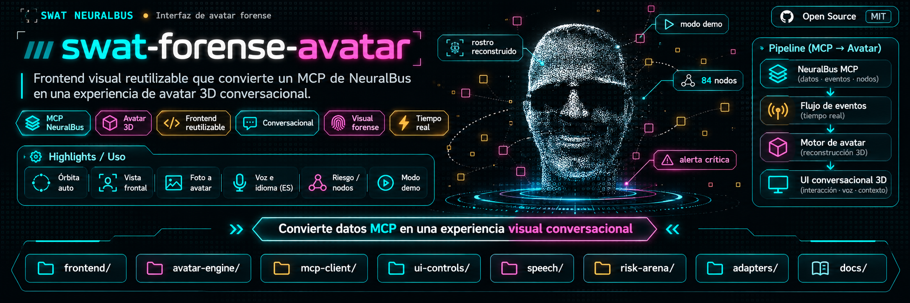
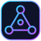
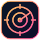
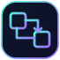
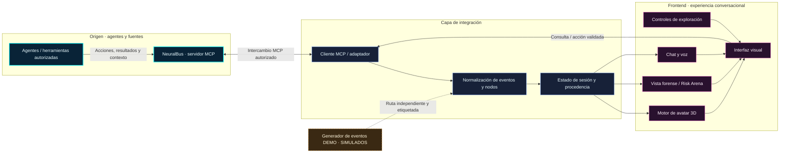

<div align="center">



# SWAT Forense Avatar

**De eventos y agentes MCP a una experiencia visual de avatar 3D conversacional.**

<p>
  
  
  
  
  
</p>

<p>
  
  
  
  
</p>

[**Visión**](#-visión) · [**Funcionalidades**](#-funcionalidades) · [**Arquitectura**](#-arquitectura-y-flujo-de-eventos) · [**Integración**](#-integración) · [**Seguridad**](#-seguridad-y-trazabilidad)

</div>

---

## 🎯 Visión

**`swat-forense-avatar`** es un **frontend visual reutilizable** cuyo objetivo es transformar los datos, eventos y estados expuestos por un servidor **MCP de NeuralBus** en una interfaz **conversacional con avatar 3D**.

En lugar de limitarse a mostrar registros o listas de herramientas, la interfaz busca representar información sobre agentes y análisis forenses mediante una presencia visual, controles de exploración, contexto conversacional y señales de riesgo.

> [!IMPORTANT]
> Este README describe la **visión y la arquitectura de referencia** a partir del material facilitado. No verifica el código existente, los endpoints MCP, la compatibilidad real con cada entorno ni el estado de implementación de los módulos. Los badges indican **tecnologías y superficies de integración**, no certificaciones ni funcionalidades comprobadas.

## ✨ Funcionalidades

<table>
<tr>
<td align="center" width="25%"><br /><strong>Avatar 3D</strong><br /><sub>Representación visual conversacional.</sub></td>
<td align="center" width="25%"><br /><strong>NeuralBus MCP</strong><br /><sub>Datos, recursos y herramientas del bus.</sub></td>
<td align="center" width="25%"><br /><strong>Agentes y nodos</strong><br /><sub>Contexto de entidades y relaciones.</sub></td>
<td align="center" width="25%"><br /><strong>Flujo de eventos</strong><br /><sub>Estados y alertas vinculados a su origen.</sub></td>
</tr>
<tr>
<td align="center"><br /><strong>Conversación</strong><br /><sub>Interacción contextual con el avatar.</sub></td>
<td align="center"><br /><strong>Voz e idioma</strong><br /><sub>Superficie de interacción por voz (ES).</sub></td>
<td align="center"><br /><strong>Risk Arena</strong><br /><sub>Visualización de nodos y señales de riesgo.</sub></td>
<td align="center"><br /><strong>Modo demo</strong><br /><sub>Experiencia simulada y etiquetada.</sub></td>
</tr>
<tr>
<td align="center"><br /><strong>Órbita automática</strong><br /><sub>Exploración visual del modelo.</sub></td>
<td align="center"><br /><strong>Foto a avatar</strong><br /><sub>Entrada de imagen para reconstrucción.</sub></td>
<td align="center"><br /><strong>Adaptadores</strong><br /><sub>Separación entre MCP y frontend.</sub></td>
<td align="center"><br /><strong>Trazabilidad</strong><br /><sub>Separación de datos reales y simulados.</sub></td>
</tr>
</table>

**Controles representados en el diseño de referencia:** órbita automática, vista frontal, foto a avatar, voz/idioma (ES), visualización de riesgo/nodos y modo demo. Su disponibilidad operativa debe contrastarse con el código del repositorio.

## 🧬 Arquitectura y flujo de eventos

El diagrama describe el **flujo objetivo de referencia**, no una afirmación de que todos los conectores ya estén implementados.



### 🔁 Cómo circula una señal

1. **Origen:** un agente o herramienta autorizado produce un resultado verificable y NeuralBus lo expone mediante su contrato MCP.
2. **Integración:** el cliente MCP obtiene la información permitida; un adaptador transforma el payload en un estado que la interfaz pueda consumir.
3. **Contexto:** se conservan, cuando existan, identidad del agente, hora, origen y relación con nodos o alertas.
4. **Visualización:** el frontend actualiza el avatar, la conversación y/o los indicadores forenses correspondientes.
5. **Interacción:** una acción del usuario se valida antes de dirigirse al cliente MCP. Mostrar información **no concede** permiso para ejecutar herramientas.
6. **Simulación:** el modo demo se mantiene separado del flujo real y se identifica visiblemente como `SIMULADO`.

## 🧩 Componentes lógicos

| Icono | Componente | Responsabilidad de referencia |
|:--:|---|---|
|  | **Cliente MCP** | Interactuar con el contrato disponible en NeuralBus. |
|  | **Adaptadores** | Traducir datos y eventos sin acoplar el frontend al proveedor. |
|  | **Estado de eventos** | Gestionar actualizaciones, procedencia, errores y sesión. |
|  | **Motor visual** | Renderizar y controlar el avatar tridimensional. |
|  | **Interfaz conversacional** | Presentar contexto y recibir interacciones. |
|  | **Voz** | Incorporar entrada/salida de audio si el proyecto la habilita. |
|  | **Risk Arena** | Representar visualmente relaciones, nodos y alertas. |
|  | **Demo** | Alimentar la interfaz con datos de ejemplo inequívocamente simulados. |

> [!NOTE]
> Estos nombres son **dominios funcionales**, no rutas de carpetas verificadas. La distribución real debe documentarse una vez se revise el árbol del repositorio.

## 🔌 Integración

La reutilización del frontend se basa en mantener clara la frontera entre **datos MCP**, **adaptación de eventos** y **presentación 3D**.

**Contrato mínimo que conviene definir en cada integración:** identidad de agente o fuente, tipo de evento, marca temporal, payload, nivel de riesgo cuando proceda, identificador de correlación y procedencia `real` o `simulada`.

<details>
<summary><strong>📦 Ejemplo ilustrativo de evento normalizado</strong> (no es el esquema oficial de NeuralBus)</summary>

```json
{
  "source": "neuralbus",
  "origin": "real",
  "agent_id": "analyst-01",
  "event_type": "risk.alert",
  "timestamp": "2026-11-07T18:00:00Z",
  "correlation_id": "example-001",
  "severity": "critical",
  "message": "Ejemplo de alerta para la interfaz",
  "payload": {
    "node_id": "example-node"
  }
}
```

**Importante:** este JSON es una propuesta de adaptación para explicar el diseño, no una respuesta MCP real ni un contrato implementado.

</details>

### Guía de conexión

- **1.** Confirmar el transporte, los recursos y las herramientas realmente expuestos por el servidor MCP.
- **2.** Configurar el endpoint y la autenticación por los mecanismos seguros que implemente el proyecto, sin incluir secretos en el cliente público.
- **3.** Construir un adaptador que valide y normalice los eventos antes de pasarlos a la UI.
- **4.** Diferenciar en pantalla los datos reales, los simulados y los estados de error/desconexión.
- **5.** Verificar la correspondencia entre eventos, avatar, chat y visualización de riesgos.

**Node.js, Python, VS Code y Codex** aparecen en los badges como superficies tecnológicas relevantes. Los comandos de instalación, las versiones, las dependencias y la compatibilidad deben confirmarse en los archivos reales del proyecto (`package.json`, entorno Python, manifiestos de integración y configuración MCP). No se inventan aquí comandos de arranque ni variables de entorno.

## 🛡️ Seguridad y trazabilidad

- **MCP no equivale a autorización:** cada llamada a herramientas debe respetar los permisos de la sesión y los controles del servidor.
- **Secretos fuera de la UI:** nunca incrustar claves privadas, tokens o credenciales en bundles de frontend ni en capturas compartidas.
- **Origen visible:** conservar la distinción entre evidencia real y datos de demostración. No atribuir una simulación a una ejecución forense.
- **Datos sensibles:** obtener consentimiento y aplicar medidas de privacidad antes de tratar fotografías, rostros o voz.
- **Errores explícitos:** indicar desconexiones, latencia y ausencia de evidencias sin sustituirlas silenciosamente por resultados ficticios.
- **Acciones externas:** ninguna transición visual debería implicar ejecución remota sin el control de autorización correspondiente.

## 🗺️ Próximos pasos de implementación

- [ ] Verificar las rutas, herramientas y contratos MCP de NeuralBus.
- [ ] Inventariar qué componentes de avatar, chat, voz y Risk Arena existen realmente.
- [ ] Definir y versionar el esquema normalizado de eventos.
- [ ] Añadir pruebas de desconexión, permisos, correlación y separación entre real/demo.
- [ ] Documentar instalación, configuración y ejecución según los manifiestos del repositorio.
- [ ] Publicar capturas o demostraciones de funcionalidades confirmadas.

## 📄 Licencia y alcance

La licencia del código deberá establecerse mediante un archivo **`LICENSE`** en la raíz del repositorio. La etiqueta «MIT» incluida en el arte del banner **no es una declaración de licencia** ni confirma que el repositorio esté publicado bajo MIT.

Las cifras, alertas y otros elementos del banner son **ilustrativos**; por ejemplo, «84 nodos» no constituye una métrica operativa verificada.

---

<div align="center">
  <strong>SWAT · NeuralBus · Forensic Visual Intelligence</strong><br />
  <sub>Una interfaz para comprender el contexto de los agentes, no para inventar evidencias.</sub>
</div>
